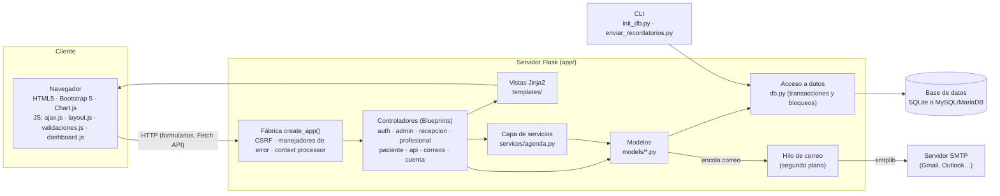
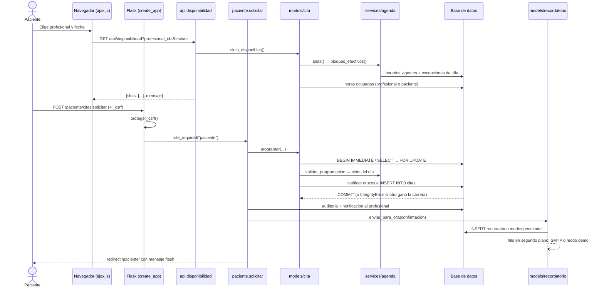
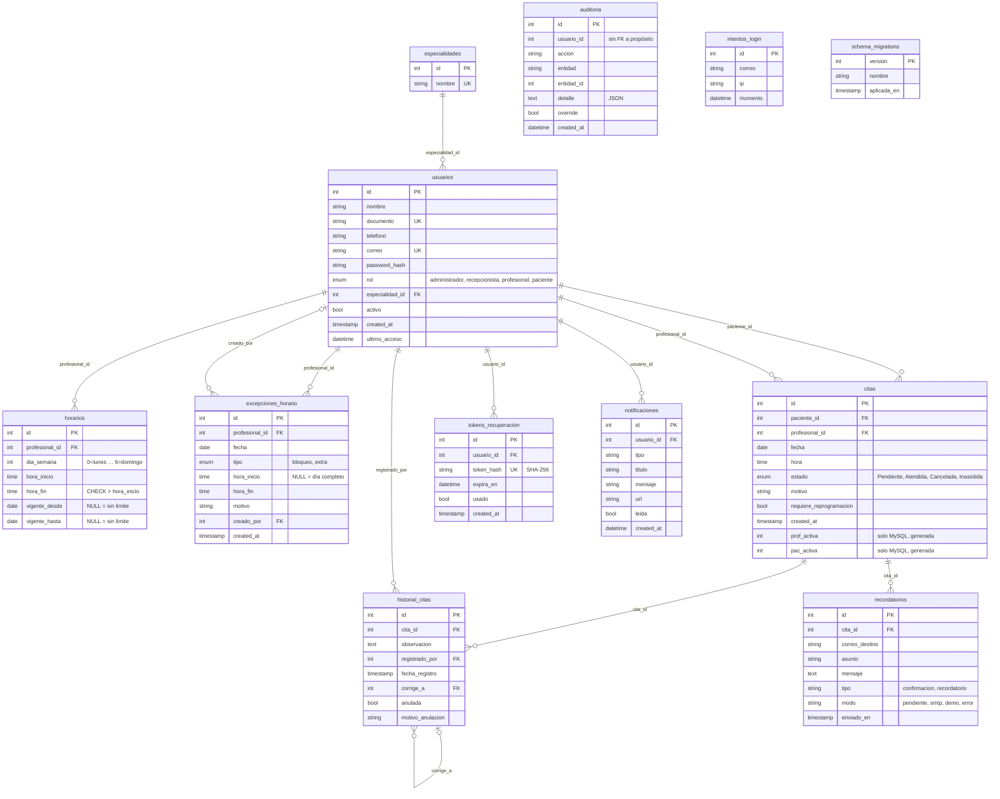
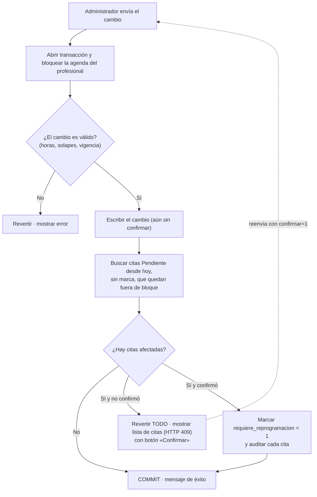

# 🏥 Sistema de Gestión de Citas Médicas

| | |
|---|---|
| **Institución** | Universidad Cooperativa de Colombia (UCC) |
| **Programa** | Ingeniería de Sistemas |
| **Asignatura** | Herramientas Computacionales — Proyecto final, Momento Evaluativo 3 |
| **Versión** | 1.0 (esquema de base de datos en la migración `006`) — TODO: confirmar número de versión |
| **Autores** | [Nombre] · [Nombre] · [Nombre] — TODO: completar |
| **Docente** | [Nombre] — TODO: completar |
| **Tecnologías** | Python 3.10+ · Flask 3 · SQLite / MySQL 8.0.16+ / MariaDB 10.4+ · Bootstrap 5 · Chart.js |
| **Video demostrativo** | TODO: enlace al video |

## Resumen ejecutivo

Aplicación web *full stack* que digitaliza la gestión de citas de un consultorio o centro de salud. Muchos
consultorios pequeños llevan la agenda en papel u hojas de cálculo, y eso causa cruces de horario, pérdida de
datos de pacientes, inasistencias sin seguimiento y falta de reportes. El sistema atiende a cuatro tipos de
usuario (administrador, recepcionista, profesional de la salud y paciente) con permisos diferenciados. Impide
la doble reserva desde la propia base de datos, limita la atención clínica al horario asignado a cada profesional,
conserva una historia clínica inmutable con auditoría, envía confirmaciones y recordatorios por correo y ofrece
reportes con gráficos y exportación a CSV.

---

## Tabla de contenidos

1. [Problema y alcance](#1-problema-y-alcance)
2. [Requisitos funcionales](#2-requisitos-funcionales)
3. [Requisitos no funcionales](#3-requisitos-no-funcionales)
4. [Arquitectura del sistema](#4-arquitectura-del-sistema)
5. [Modelo de datos](#5-modelo-de-datos)
6. [Reglas de negocio](#6-reglas-de-negocio)
7. [Seguridad](#7-seguridad)
8. [Instalación paso a paso](#8-instalación-paso-a-paso)
9. [Migraciones de base de datos](#9-migraciones-de-base-de-datos)
10. [Configuración de correo](#10-configuración-de-correo)
11. [Uso del sistema](#11-uso-del-sistema)
12. [API interna y rutas](#12-api-interna-y-rutas)
13. [Pruebas](#13-pruebas)
14. [Estructura del código y convenciones](#14-estructura-del-código-y-convenciones)
15. [Despliegue en producción](#15-despliegue-en-producción)
16. [Limitaciones conocidas y trabajo futuro](#16-limitaciones-conocidas-y-trabajo-futuro)
17. [Créditos y licencia](#17-créditos-y-licencia)
18. [Anexos: glosario](#18-anexos-glosario)

---

## 1. Problema y alcance

### 1.1 Necesidad identificada

| Problema en la gestión manual | Cómo lo resuelve el sistema |
|---|---|
| Dos pacientes reciben la misma hora con el mismo profesional | Validación de cruces en una transacción con bloqueo e índices únicos en la base de datos |
| Se agendan citas cuando el profesional no atiende | Disponibilidad calculada a partir del horario semanal vigente, bloqueos y turnos extra |
| Datos de pacientes dispersos o perdidos | Registro centralizado de pacientes con búsqueda y paginación |
| Inasistencias frecuentes | Confirmación al agendar y recordatorio por correo el día anterior |
| Notas clínicas modificables sin rastro | Historia clínica inmutable (corrección y anulación con motivo) y auditoría |
| Sin información para la gestión | Panel con indicadores, gráficos por estado y por profesional, y exportación CSV |

### 1.2 Objetivo general

Desarrollar una aplicación web con arquitectura MVC en Python y Flask que gestione el ciclo de vida de las citas
médicas (solicitud, programación, reprogramación, atención, cancelación y seguimiento) para los cuatro roles del
consultorio, garantizando la integridad de la agenda y la trazabilidad de la información clínica.

### 1.3 Objetivos específicos

1. Implementar control de acceso por rol con autenticación segura y protección CSRF.
2. Garantizar que no existan dos citas activas para el mismo profesional, o para el mismo paciente, en la misma
   fecha y hora.
3. Calcular la disponibilidad de cada profesional a partir de su horario semanal con vigencia y de las excepciones
   por fecha.
4. Restringir el registro de la atención al profesional asignado, el día de la cita y dentro de su turno.
5. Mantener una historia clínica inmutable y un registro de auditoría de las acciones relevantes.
6. Enviar confirmaciones y recordatorios por correo sin bloquear la interfaz.
7. Ofrecer reportes filtrables con gráficos y exportación a CSV.
8. Soportar SQLite (sin instalación) y MySQL/MariaDB mediante migraciones versionadas.

### 1.4 Alcance

| Incluido | Excluido |
|---|---|
| Gestión de usuarios, especialidades y pacientes | Facturación, pagos y convenios con EPS |
| Agenda con horario semanal, vigencias, bloqueos y turnos extra | Historia clínica electrónica completa (diagnósticos codificados, fórmulas, órdenes) |
| Solicitud de citas en línea por el paciente | Teleconsulta o videollamada |
| Registro de atención y notas clínicas del profesional | Aplicación móvil nativa (la web es *responsive*) |
| Confirmaciones y recordatorios por correo | Mensajes por SMS o WhatsApp |
| Centro de notificaciones internas | Varias sedes o consultorios dentro de una misma instalación |
| Reportes con gráficos y CSV | Duración de cita variable por especialidad (ver [§16](#16-limitaciones-conocidas-y-trabajo-futuro)) |
| Descarga de datos personales (Ley 1581 de 2012) | Integraciones con sistemas externos de salud |

---

## 2. Requisitos funcionales

Las historias de usuario **HU-01 a HU-10** aparecen referenciadas en el código y en los mensajes de la interfaz.

| HU | Historia |
|---|---|
| HU-01 | Como recepcionista, quiero registrar y administrar pacientes. |
| HU-02 | Como recepcionista, quiero agendar citas sin cruces de horario. |
| HU-03 | Como paciente, quiero solicitar una cita en línea viendo solo las horas libres. |
| HU-04 | Como paciente, quiero reprogramar o cancelar mi cita con anticipación. |
| HU-05 | Como administrador, quiero definir el horario de atención de cada profesional. |
| HU-06 | Como profesional, quiero ver mi agenda diaria y registrar la atención. |
| HU-07 | Como paciente, quiero recibir confirmaciones y recordatorios de mis citas. |
| HU-08 | Como profesional, quiero consultar el historial de mis pacientes y registrar notas clínicas. |
| HU-09 | Como recepcionista, quiero cancelar citas. |
| HU-10 | Como administrador, quiero ver reportes e indicadores y exportarlos. |

### 2.1 Administrador

| ID | HU | Requisito |
|---|---|---|
| RF-01 | HU-10 | Mostrar un panel con totales (citas, pendientes, pacientes, profesionales) y gráficos por estado y por profesional. |
| RF-02 | HU-10 | Filtrar el reporte por periodo (hoy, próximos 7 días, últimos 7 días, mes actual, rango o todos), profesional, estado y texto libre, con actualización dinámica. |
| RF-03 | HU-10 | Exportar el reporte filtrado a CSV (con BOM para Excel), con un máximo de `REPORT_MAX_ROWS` filas y aviso cuando se trunca. |
| RF-04 | — | Crear, editar, activar, desactivar y eliminar usuarios de cualquier rol. No permite eliminar usuarios con citas ni eliminarse o desactivarse a sí mismo. |
| RF-05 | — | Crear, renombrar y eliminar especialidades. No permite eliminar una especialidad asignada a profesionales. |
| RF-06 | HU-05 | Definir el horario semanal de cada profesional por bloques (día, hora de inicio y fin) con fechas de vigencia. |
| RF-07 | HU-05 | Registrar excepciones por fecha: bloqueos parciales o de día completo y turnos extra, con motivo obligatorio. |
| RF-08 | HU-05 | Antes de guardar un cambio de agenda, mostrar las citas pendientes afectadas y exigir confirmación. |
| RF-09 | — | Forzar el registro de una atención (Atendida, Inasistida o Pendiente) con motivo obligatorio y registro en auditoría (*override*). |
| RF-10 | HU-07 | Encolar los recordatorios de las citas de mañana con un botón. |
| RF-11 | — | Acceder a todas las funciones del módulo de recepción. |

### 2.2 Recepcionista

| ID | HU | Requisito |
|---|---|---|
| RF-12 | HU-01 | Registrar, editar, activar, desactivar y eliminar pacientes (sin citas), con búsqueda en vivo y paginación. Si no se define contraseña, el sistema genera una temporal y la muestra una sola vez. |
| RF-13 | HU-02 | Agendar y editar citas mostrando solo horas disponibles y rechazando cruces del profesional o del paciente. |
| RF-14 | HU-09 | Cancelar citas. Recepción no puede marcar Atendida ni Inasistida. |
| RF-15 | — | Eliminar citas que no tengan notas clínicas asociadas. |
| RF-16 | — | Listar y filtrar las citas que requieren reprogramación y reagendarlas (al hacerlo se limpia la marca). |
| RF-17 | HU-07 | Enviar un recordatorio individual por correo para una cita. |
| RF-18 | — | Filtrar citas por texto, estado, profesional y rango de fechas. |

### 2.3 Profesional de la salud

| ID | HU | Requisito |
|---|---|---|
| RF-19 | HU-06 | Ver la agenda de un día con sus franjas efectivas, el turno en curso y navegación al día anterior o siguiente. |
| RF-20 | HU-06 | Marcar una cita como Atendida, Inasistida o Pendiente solo si se cumple la regla [`puede_atender`](#62-regla-de-atención-puede_atender). Los botones no permitidos aparecen deshabilitados con el motivo. |
| RF-21 | HU-08 | Consultar el historial de los pacientes con los que tiene o tuvo citas (cada consulta queda en auditoría). |
| RF-22 | HU-08 | Registrar notas clínicas, corregirlas (nueva versión enlazada) y anularlas con motivo. |

### 2.4 Paciente

| ID | HU | Requisito |
|---|---|---|
| RF-23 | — | Registrarse por cuenta propia. |
| RF-24 | HU-03 | Solicitar una cita eligiendo profesional, fecha y una de las horas libres, con motivo de 3 a 255 caracteres. |
| RF-25 | HU-04 | Reprogramar o cancelar una cita pendiente con al menos `ANTICIPACION_HORAS` de anticipación. |
| RF-26 | HU-07 | Recibir confirmación al solicitar o reprogramar y recordatorio el día anterior; solicitar un recordatorio y ver los correos registrados. |
| RF-27 | — | Descargar una cita como archivo `.ics` para agregarla a su calendario. |

### 2.5 Comunes a todos los roles

| ID | Requisito |
|---|---|
| RF-28 | Iniciar y cerrar sesión; recuperar la contraseña mediante un enlace de un solo uso. |
| RF-29 | *Mi cuenta*: editar datos personales (no el documento ni la especialidad), cambiar la contraseña, elegir tema claro/oscuro/sistema, ver la actividad reciente y el último acceso. |
| RF-30 | Descargar los datos personales propios en JSON. |
| RF-31 | Centro de notificaciones: campana con contador que se actualiza cada 45 s, página con filtro de no leídas, marcar como leídas, eliminar y limpiar leídas. |

---

## 3. Requisitos no funcionales

| Categoría | Requisito | Implementación |
|---|---|---|
| **Seguridad** | Contraseñas protegidas | Hash PBKDF2-SHA256 (Werkzeug). Ver [§7](#7-seguridad). |
| | Protección de formularios | Token CSRF obligatorio en todo `POST`, `PUT`, `PATCH` y `DELETE`. |
| | Control de acceso | Decorador `role_required` en cada ruta; revalida en cada petición que el usuario siga activo. |
| | Configuración segura por defecto | `APP_ENV` vale `production` si no se define; en producción la app no arranca sin una `SECRET_KEY` propia. |
| **Integridad** | Sin doble reserva | Índices únicos parciales (SQLite) o columnas generadas con `UNIQUE` (MySQL), más validación transaccional. |
| | Trazabilidad | Historia clínica inmutable y tabla `auditoria`. |
| **Rendimiento** | Listados acotados | Paginación de citas, pacientes, usuarios y notificaciones con `PAGE_SIZE` (20 por defecto). La tabla del panel muestra máximo 500 filas; el CSV, `REPORT_MAX_ROWS` (5000). |
| | Consultas indexadas | Índices por `(profesional_id, fecha)`, `paciente_id`, auditoría, intentos de login, excepciones y notificaciones. |
| | Respuesta inmediata | Los correos se envían en un hilo en segundo plano (`MAIL_ASYNC=1`). |
| **Disponibilidad** | Fallos controlados | Si la base de datos no responde se muestra una página 503 con instrucciones. Un fallo SMTP queda registrado y no interrumpe la operación. Las notificaciones nunca rompen el flujo principal. |
| | Recuperación de la cola | Los correos que quedaron `pendiente` (por ejemplo, tras un reinicio) se reintentan con `enviar_recordatorios.py` o `AUTO_REMINDERS=1`. |
| | Alcance | Despliegue en un solo servidor; no hay alta disponibilidad ni réplicas. |
| **Usabilidad** | Interfaz adaptable | Bootstrap 5 y *media queries*; barra lateral contraíble y deslizable en celular. |
| | Retroalimentación | Mensajes `flash`, motivos en *tooltips*, búsquedas en vivo, tema claro/oscuro, estilos de impresión. |
| | Validación doble | `app/validators.py` (servidor) y `static/js/validaciones.js` (cliente). |
| **Zona horaria** | "Hoy" y "ahora" coherentes | `TZ` (por defecto `America/Bogota`) define el reloj del negocio en toda la app (`utils.ahora()` / `utils.hoy()`). Las marcas de tiempo que escribe la app usan esa hora. Requiere el paquete `tzdata` en Windows. |
| **Privacidad** (Ley 1581 de 2012) | Minimización | Los correos y notificaciones no incluyen el motivo de consulta ni contenido clínico. La auditoría guarda solo ids, estados y motivos. |
| | Derecho de acceso | Descarga de los datos propios en `/cuenta/mis-datos.json`. |
| | Datos sensibles fuera de la sesión | Nada sensible viaja en mensajes `flash` (la cookie de sesión es legible en el navegador). |
| | Acceso restringido al historial | Solo profesionales con citas con el paciente; cada lectura se audita; respuesta `Cache-Control: no-store`. |
| **Mantenibilidad** | Arquitectura en capas | MVC con capa de servicios; un único servicio de agenda. |
| | Esquema versionado | Migraciones numeradas para SQLite y MySQL. |
| | Pruebas automatizadas | 91 pruebas con `unittest` (ver [§13](#13-pruebas)). |

---

## 4. Arquitectura del sistema

### 4.1 Diagrama de componentes



### 4.2 Capas

| Capa | Ubicación | Responsabilidad |
|---|---|---|
| **Presentación (Vista)** | `app/templates/`, `app/static/` | Plantillas Jinja2 por rol, parciales (`_*.html`) que se recargan por AJAX, macros, CSS propio y JavaScript. |
| **Controladores** | `app/controllers/` | Un *Blueprint* por módulo. Leen la petición, validan permisos y entrada, llaman a modelos y servicios, registran auditoría y notificaciones, y responden (HTML, JSON, CSV, ICS). |
| **Servicios** | `app/services/agenda.py` | Lógica de negocio de la agenda: bloques efectivos, horas disponibles, regla de atención, turno en curso y análisis de impacto. Es el **único** lugar donde se calcula la disponibilidad. |
| **Modelos** | `app/models/` | Consultas SQL parametrizadas por entidad (usuario, cita, horario, excepción, historial, recordatorio, auditoría, seguridad, notificación, especialidad). |
| **Acceso a datos** | `app/db.py` | Misma interfaz para SQLite y MySQL: traduce marcadores `%s` → `?`, normaliza fechas y horas a texto, maneja transacciones y bloqueos por usuario. |
| **Transversales** | `app/utils.py`, `app/validators.py`, `config.py` | Roles, CSRF, reloj de negocio, redirecciones seguras, paginación, validaciones y configuración desde `.env`. |

### 4.3 Estructura de carpetas

```text
proyecto_citas_medicas/
├── run.py                      # Punto de entrada (debug solo con FLASK_DEBUG=1)
├── config.py                   # Configuración: lee .env y define valores por defecto
├── init_db.py                  # Aplica migraciones, siembra datos demo, crea administradores
├── enviar_recordatorios.py     # Envío programable de recordatorios de mañana (cron / Programador de tareas)
├── migrations/                 # 001 … 006: un .sqlite.sql y un .mysql.sql por versión
├── seed_demo.sql               # Datos y contraseñas de DEMOSTRACIÓN (solo desarrollo)
├── database.sql                # Esquema MySQL consolidado (= migraciones 001-006, sin datos)
├── database_sqlite.sql         # Esquema SQLite consolidado (= migraciones 001-006, sin datos)
├── requirements.txt
├── .env.example                # Plantilla de configuración (copiar como .env)
├── app/
│   ├── __init__.py             # create_app(): validación de configuración, CSRF, errores, Blueprints
│   ├── db.py                   # Acceso a datos MySQL/SQLite, transacciones y bloqueo por usuario
│   ├── utils.py                # Roles, CSRF, reloj de negocio (TZ), redirecciones seguras, paginación
│   ├── validators.py           # Validación de formularios de personas
│   ├── services/
│   │   └── agenda.py           # Servicio único de agenda
│   ├── models/                 # auditoria, cita, especialidad, excepcion, historial, horario,
│   │                           # notificacion, recordatorio, seguridad, usuario
│   ├── controllers/            # admin, api, auth, correos, cuenta, paciente, profesional, recepcion
│   ├── templates/
│   │   ├── base.html · _macros.html
│   │   ├── admin/ · recepcion/ · profesional/ · paciente/
│   │   ├── auth/ · cuenta/ · correos/ · errors/
│   └── static/
│       ├── css/styles.css
│       └── js/ ajax.js · dashboard.js · layout.js · main.js · validaciones.js
└── tests/
    ├── test_app.py             # 30 pruebas de integración originales
    ├── test_correcciones.py    # 18 pruebas de seguridad, concurrencia y migraciones
    ├── test_agenda.py          # 29 pruebas de horario y regla de atención
    └── test_cuenta.py          # 14 pruebas de cuenta, notificaciones y diseño
```

### 4.4 Flujo de una petición: el paciente solicita una cita



Paso a paso:

1. **Consulta de horas libres.** Al elegir profesional y fecha, `ajax.js` llama por Fetch a
   `GET /api/disponibilidad`. El endpoint obtiene las horas del día con `services.agenda.slots()` (a partir de los
   bloques efectivos), descarta las ocupadas por el profesional o por el propio paciente y las que ya pasaron, y
   responde `{"slots": [...], "mensaje": "..."}`.
2. **Envío del formulario.** El navegador hace `POST /paciente/citas/solicitar` con `_csrf`, `profesional_id`,
   `fecha`, `hora` y `motivo`.
3. **Middleware.** `proteger_csrf()` (en `app/__init__.py`) compara el token con el de la sesión; si no coincide
   responde 400.
4. **Control de acceso.** `role_required("paciente")` exige sesión, vuelve a leer el usuario de la base de datos y
   verifica que siga activo y tenga el rol.
5. **Validación de entrada.** El controlador valida el motivo (3 a 255 caracteres).
6. **Transacción.** `cita.programar()` abre una transacción (`BEGIN IMMEDIATE` en SQLite; `SELECT … FOR UPDATE`
   sobre las filas del profesional y del paciente en MySQL) y, dentro de ella, `validar_programacion()` comprueba:
   profesional y paciente activos, formato de fecha y hora, que sea en el futuro, que la hora esté entre las del
   día y que no haya cruce. Luego inserta la cita.
7. **Última barrera.** Si otra petición reservó la misma hora en paralelo, los índices únicos lanzan
   `IntegrityError` y el usuario ve: *"Ese horario acaba de ser reservado por otra persona…"*.
8. **Efectos secundarios.** Se registra la auditoría (`crear`, `cita`), se notifica al profesional y se encola el
   correo de confirmación (fila `pendiente` en `recordatorios`, procesada por un hilo).
9. **Respuesta.** Mensaje `flash` y redirección al panel del paciente (patrón *Post/Redirect/Get*).

---

## 5. Modelo de datos

### 5.1 Diagrama entidad-relación



### 5.2 Descripción de las tablas

| Tabla | Propósito | Restricciones e índices relevantes |
|---|---|---|
| `especialidades` | Catálogo de especialidades médicas. | `nombre` único. |
| `usuarios` | Todas las personas del sistema; el rol determina los permisos. | `documento` y `correo` únicos. `rol` como `ENUM` (MySQL) o `CHECK` (SQLite). `especialidad_id` → `ON DELETE SET NULL ON UPDATE CASCADE`. `activo` permite desactivar sin borrar. |
| `horarios` | Bloques semanales recurrentes de cada profesional, con vigencia. | `CHECK dia_semana BETWEEN 0 AND 6`; `CHECK hora_fin > hora_inicio`; índice `(profesional_id, dia_semana)`; `ON DELETE CASCADE`. Desde la 005 ya no hay `UNIQUE` por día y hora. |
| `excepciones_horario` | Bloqueos y turnos extra en una fecha concreta. | `tipo IN ('bloqueo','extra')`. `CHECK`: o ambas horas son `NULL` y el tipo es `bloqueo` (día completo), o ambas existen y `hora_fin > hora_inicio`. Índice `(profesional_id, fecha)`. |
| `citas` | Citas entre un paciente y un profesional. | `estado` restringido a 4 valores. FK a `usuarios` con `ON DELETE RESTRICT`. Índices `(profesional_id, fecha)` y `paciente_id`. Unicidad de citas activas (ver abajo). |
| `historial_citas` | Notas clínicas inmutables asociadas a una cita. | `cita_id` → `CASCADE`; `registrado_por` → `RESTRICT`; `corrige_a` → autorreferencia con `SET NULL`; índice sobre `corrige_a`. |
| `recordatorios` | Registro y cola de correos (confirmaciones y recordatorios). | `cita_id` → `CASCADE`. `modo` indica el estado del envío. |
| `tokens_recuperacion` | Tokens de restablecimiento de contraseña. | Se guarda solo el hash SHA-256 (`UNIQUE`); `usuario_id` → `CASCADE`. |
| `notificaciones` | Avisos internos de la campana. | Índice `(usuario_id, leida, id)`; `usuario_id` → `CASCADE`. |
| `auditoria` | Traza de acciones. | `usuario_id` **sin** llave foránea para conservar la traza aunque se elimine el usuario. Índices `(entidad, entidad_id)` y `(usuario_id, created_at)`. |
| `intentos_login` | Intentos fallidos de inicio de sesión. | Índice `(correo, ip, momento)`. Se purgan los de más de un día. |
| `schema_migrations` | Versiones del esquema aplicadas. | `version` como llave primaria. |

### 5.3 Restricciones de integridad destacadas

**Una sola cita activa por profesional (y por paciente) en cada fecha y hora.** Una cita cancelada no debe
bloquear el horario, por eso la unicidad aplica solo a citas con `estado <> 'Cancelada'`:

* **SQLite: índices únicos parciales.**

  ```sql
  CREATE UNIQUE INDEX uq_citas_prof_activa ON citas (profesional_id, fecha, hora) WHERE estado <> 'Cancelada';
  CREATE UNIQUE INDEX uq_citas_pac_activa  ON citas (paciente_id,   fecha, hora) WHERE estado <> 'Cancelada';
  ```

* **MySQL: columnas generadas.** MySQL no admite índices parciales. Se crean columnas `STORED` que valen `NULL`
  cuando la cita está cancelada; como `UNIQUE` admite varios `NULL`, las canceladas no chocan entre sí.

  ```sql
  ALTER TABLE citas
      ADD COLUMN prof_activa INT GENERATED ALWAYS AS (IF(estado <> 'Cancelada', profesional_id, NULL)) STORED,
      ADD COLUMN pac_activa  INT GENERATED ALWAYS AS (IF(estado <> 'Cancelada', paciente_id,   NULL)) STORED,
      ADD UNIQUE KEY uq_citas_prof_activa (prof_activa, fecha, hora),
      ADD UNIQUE KEY uq_citas_pac_activa  (pac_activa,  fecha, hora);
  ```

  Consecuencia: reactivar una cita cancelada cuyo horario ya ocupa otra lanza `IntegrityError`, que la aplicación
  traduce a *"No se puede reactivar: ese horario ya está ocupado por otra cita."*

**`CHECK` de horas.** `hora_fin > hora_inicio` en `horarios` (`chk_horas` en MySQL) y en `excepciones_horario`
(`chk_exc_horas`) impide guardar turnos que crucen la medianoche, incluso si alguien escribe directamente en la base
de datos. Por eso se exige MySQL **8.0.16+** (la primera versión que aplica los `CHECK`) o MariaDB 10.4+.

**`requiere_reprogramacion`.** En SQLite tiene `CHECK (requiere_reprogramacion IN (0, 1))`; en MySQL es
`TINYINT(1) NOT NULL DEFAULT 0`.

**Borrado protegido.** Las citas usan `ON DELETE RESTRICT` hacia `usuarios`. Además, la aplicación impide eliminar
usuarios con citas, citas con notas clínicas y especialidades con profesionales.

---

## 6. Reglas de negocio

Toda la lógica de disponibilidad y de atención vive en **`app/services/agenda.py`**. No hay otro lugar donde se
calcule.

### 6.1 Bloques efectivos

Los bloques efectivos son los intervalos en los que un profesional atiende en una fecha concreta:

```text
bloques_efectivos(profesional, fecha) =
      fusionar( bloques semanales vigentes en esa fecha )
    − bloqueos de ese día            (un bloqueo sin horas vacía el día)
    + turnos extra de ese día
  → lista ordenada y fusionada de intervalos [inicio, fin) en minutos
```

1. **Semanales vigentes:** filas de `horarios` con `dia_semana = fecha.weekday()` y
   `vigente_desde ≤ fecha ≤ vigente_hasta` (un `NULL` significa sin límite). Los intervalos solapados o contiguos se
   fusionan.
2. **Bloqueos:** cada bloqueo parcial se resta del resultado anterior; un bloqueo de día completo lo deja vacío.
3. **Turnos extra:** se suman **después** de los bloqueos y se vuelve a fusionar. Un turno extra se aplica aunque el
   mismo día tenga un bloqueo de día completo.

**Ejemplo.** Lunes con horario 08:00–12:00 y 14:00–17:00, un bloqueo 10:00–11:00 y un turno extra 17:00–19:00:

| Paso | Resultado |
|---|---|
| Semanales | `[08:00–12:00, 14:00–17:00]` |
| − bloqueo 10:00–11:00 | `[08:00–10:00, 11:00–12:00, 14:00–17:00]` |
| + extra 17:00–19:00 (se fusiona por ser contiguo) | `[08:00–10:00, 11:00–12:00, 14:00–19:00]` |

**Horas ofrecidas (`slots`).** Dentro de cada bloque se generan horas desde el inicio del bloque, cada
`duracion_cita()` minutos (hoy `SLOT_MINUTES`), mientras la cita termine dentro del bloque. Con 30 minutos, el bloque
`08:00–10:00` ofrece 08:00, 08:30, 09:00 y 09:30. `slots_disponibles()` descarta además las horas ocupadas por el
profesional o por el paciente (citas no canceladas) y las que ya pasaron.

**Una cita está en bloque** (`en_bloque`) si empieza dentro de un bloque efectivo y termina antes o justo en su fin.

Lo usan: la disponibilidad al agendar y reprogramar, `validar_programacion`, `/api/disponibilidad`, la agenda del
profesional, la regla de atención y el análisis de impacto.

### 6.2 Regla de atención: `puede_atender`

`puede_atender(cita, profesional, momento, estado)` devuelve `(True, "")` o `(False, motivo)`. Se evalúan en este
orden:

| # | Condición | Motivo si falla |
|---|---|---|
| 1 | Es el **profesional asignado** a la cita. | "Solo el profesional asignado puede atender esta cita." |
| 2 | La cita **no está cancelada**. | "La cita está cancelada." |
| 3 | El profesional **tiene bloques efectivos** en la fecha de la cita. | "Hoy no tiene horario de atención." |
| 4 | La cita **cae dentro de un bloque** efectivo de ese día. | "La cita está fuera de la franja de atención de ese día." |
| 5 | `requiere_reprogramacion = 0`. | "…recepción debe reagendarla." |
| 6 | La fecha de la cita es **hoy** en la zona `TZ`. | "Solo se puede atender el día de la cita (…)." |
| 7 | La **hora actual** está dentro de un turno efectivo de hoy (entrada inclusiva, salida exclusiva: con salida a las 12:00 se atiende a las 11:59, no a las 12:00). | "Fuera de su horario de atención (ahora son las …; su turno empieza / terminó / está en pausa…)." |
| 8 | Solo para **Inasistida**: han pasado `TOLERANCIA_INASISTENCIA_MIN` minutos (15 por defecto) desde la hora de la cita. | "Podrá marcar Inasistida desde las HH:MM…" |

Se aplica a cambiar el estado (Atendida, Inasistida, Pendiente) y a **crear o corregir** notas clínicas. **Anular**
una nota no exige la regla, solo ser su autor y dar un motivo.

En la agenda, los botones que no cumplen la regla aparecen deshabilitados con el motivo en un *tooltip*, las citas
fuera de franja se resaltan y, si el profesional no tiene bloques ese día, se muestra "No atiende hoy". Consultar el
historial de un paciente solo requiere que el profesional tenga o haya tenido alguna cita con él; cada consulta queda
en auditoría.

### 6.3 Override del administrador

Para casos excepcionales (por ejemplo, el profesional olvidó registrar la atención), el administrador puede **forzar
una atención** desde *Citas → botón de escudo (🛡️)* (`/admin/citas/<id>/atencion`):

* Estados permitidos: Pendiente, Atendida o Inasistida.
* **Motivo obligatorio** de 5 a 255 caracteres.
* La pantalla muestra qué regla se incumpliría.
* Se registra en `auditoria` con `accion = 'forzar_atencion'`, `override = 1` y en `detalle` el estado anterior,
  el nuevo, el motivo y la regla incumplida.
* No aplica a notas clínicas: el administrador no es personal clínico.
* Recepción no tiene esta opción: solo puede cancelar.

### 6.4 Cambios de horario con análisis de impacto

**Vigencia.** Cada bloque semanal tiene `vigente_desde` y `vigente_hasta`. Un bloque nuevo puede empezar hoy o en el
futuro, nunca en el pasado.

**Editar y eliminar no sobrescriben.** Así las fechas pasadas conservan el horario que tenían:

* **Editar**: se cierra el bloque (`vigente_hasta` = día anterior al corte) y se crea uno nuevo desde el corte con el
  mismo `vigente_hasta` original. El corte es hoy o, si el bloque aún no había empezado, su `vigente_desde`.
* **Eliminar**: se cierra el bloque de la misma forma. El registro se conserva y puede verse con el filtro de
  historial.

**Solapes.** No se permiten dos bloques semanales del mismo día que se crucen en horas **y** en vigencia, ni dos
excepciones del mismo tipo que se crucen el mismo día (un bloqueo de día completo se cruza con cualquier otro
bloqueo). Un turno extra sí puede solaparse con el horario semanal: se fusionan.

**Flujo de impacto** (`aplicar_cambio`), común a crear, editar o eliminar bloques y a crear o eliminar excepciones:



Después de confirmar:

* El estado de la cita **no cambia** (sigue Pendiente); solo se activa la marca.
* Recepción ve esas citas en su panel y con el filtro *"Solo citas que requieren reprogramación"*. Al reagendarlas,
  la marca se limpia.
* El profesional no puede atenderlas, el paciente las ve señaladas y no reciben recordatorio automático.
* Si un cambio posterior vuelve a cubrir una cita marcada, la marca **no** se quita sola. Es una decisión
  conservadora: alguien debe confirmar la hora con el paciente.

**Profesional desactivado.** Al desactivar a un profesional, todas sus citas Pendiente desde hoy quedan con
`requiere_reprogramacion = 1` en la misma transacción, y se notifica a recepcionistas y administradores.

### 6.5 Concurrencia

| Mecanismo | SQLite | MySQL / MariaDB |
|---|---|---|
| Transacción | `BEGIN IMMEDIATE`: toma el bloqueo de escritura al inicio y serializa a los escritores. | `conn.begin()` con InnoDB. |
| Bloqueo de agenda | Implícito en `BEGIN IMMEDIATE`. | `SELECT id FROM usuarios WHERE id = … FOR UPDATE` sobre el profesional (y el paciente al agendar), en orden de id para evitar interbloqueos. |
| Última barrera | Índices únicos parciales. | Columnas generadas con `UNIQUE`. |

Se aplica en: programar y reprogramar citas, cambios de horario y excepciones, y activar o desactivar usuarios. Las
pruebas lanzan dos hilos que reservan la misma hora o crean bloques solapados a la vez y verifican que solo uno gane.

### 6.6 Otras reglas

| Tema | Regla |
|---|---|
| Anticipación del paciente | Solo puede reprogramar o cancelar citas Pendiente si faltan al menos `ANTICIPACION_HORAS` (2 por defecto). |
| Fechas | No se agenda en fechas u horas pasadas. |
| Estados que registra recepción | Solo Cancelada. Reactivar una cita cancelada equivale a agendar una nueva. |
| Notas clínicas | Inmutables. *Corregir* crea una nota nueva con `corrige_a` (solo sobre la versión vigente; mínimo 5 caracteres). *Anular* exige un motivo de 5 a 255 caracteres; la nota sigue visible y tachada. |
| Eliminaciones | Usuarios con citas, citas con notas y especialidades con profesionales no se eliminan: se desactivan o se cancelan. |
| Validaciones de personas | Nombre de 3 a 100 caracteres; documento de 5 a 15 dígitos; teléfono de 7 a 15 dígitos (obligatorio para pacientes); correo válido; contraseña de al menos 6 caracteres (8 al crear un administrador con `init_db.py --admin`). |
| Recordatorio automático | Solo para citas Pendiente de mañana sin marca de reprogramación y que aún no tengan recordatorio (en cola o enviado). |

---

## 7. Seguridad

| Control | Implementación | Ubicación |
|---|---|---|
| **Hash de contraseñas** | `generate_password_hash(pw, method="pbkdf2:sha256")` con sal aleatoria; verificación con `check_password_hash`. | `models/usuario.py` |
| **CSRF** | Token aleatorio por sesión (`secrets.token_hex(16)`), comparado con `hmac.compare_digest`. Se envía como campo `_csrf` o encabezado `X-CSRF-Token` (Fetch). Se regenera al iniciar sesión. Sin token válido: HTTP 400. | `utils.py`, `__init__.py` |
| **Control de acceso por rol** | `role_required(*roles)` en cada ruta: exige sesión, relee el usuario en cada petición, cierra la sesión si fue desactivado y responde 403 si el rol no corresponde. Además, cada recurso valida la propiedad (cita propia, nota propia, notificación propia). | `utils.py`, controladores |
| **Sesión** | Cookie `HttpOnly`, `SameSite=Lax`, duración de 8 horas; `SESSION_COOKIE_SECURE` configurable. `debug` solo con `FLASK_DEBUG=1`. | `config.py`, `run.py` |
| **Configuración** | Fuera de desarrollo la app no arranca (`ConfiguracionInsegura`) si `SECRET_KEY` falta, tiene menos de 16 caracteres o es una de las de ejemplo. | `__init__.py`, `config.py` |
| **Límite de intentos de login** | Máximo `LOGIN_MAX_INTENTOS` (5) fallos en `LOGIN_VENTANA_MIN` (15) minutos por la pareja **correo + IP**, con mensaje genérico y HTTP 429. Contar por pareja evita que un atacante bloquee la cuenta de otra persona desde otra IP. El formulario de recuperación también suma intentos. El contador se limpia al iniciar sesión o al restablecer la contraseña. | `models/seguridad.py`, `controllers/auth.py` |
| **Recuperación de contraseña** | Token `secrets.token_urlsafe(32)`; en la base solo se guarda su SHA-256. Vence en `RESET_TOKEN_MIN` (30) minutos, es de un solo uso (`UPDATE … WHERE usado = 0` atómico) y crear uno invalida los anteriores. Respuesta idéntica exista o no la cuenta. Páginas con `Cache-Control: no-store` y `Referrer-Policy: no-referrer`. Sin SMTP, el enlace solo se muestra en pantalla en desarrollo y nunca se guarda en la sesión. | `models/seguridad.py`, `controllers/auth.py` |
| **Redirecciones** | `next` y `referrer` solo se aceptan si empiezan por `/` y no por `//` ni `/\`. Recepción solo acepta `next` dentro de `/recepcion` o `/admin`. | `utils.destino_seguro`, `controllers/recepcion.py` |
| **Inyección SQL** | Todas las consultas usan parámetros; los `LIMIT`/`OFFSET` se convierten con `int()`. | `models/` |
| **Datos sensibles fuera del `flash`** | La contraseña temporal de un paciente se muestra una sola vez en una página `no-store`. El cuerpo de los correos en modo demo solo se ve en la vista previa protegida por rol. | `controllers/recepcion.py`, `controllers/correos.py` |
| **Historial inmutable** | Las notas no se actualizan ni se borran: corregir inserta una nota nueva y anular solo marca `anulada = 1` con motivo. | `models/historial.py` |
| **Auditoría** | Registra: creación, corrección y anulación de notas; cambios de estado; creación, reprogramación y eliminación de citas; cambios de horarios y excepciones; altas, ediciones, activaciones y eliminaciones de usuarios; lecturas del historial; marcas de reprogramación; *overrides*; solicitud y restablecimiento de contraseña; cambio de contraseña; exportación de datos. No guarda contenido clínico. | `models/auditoria.py` |
| **Errores** | Páginas propias para 400, 403, 404, 405, 500 y 503; en `/api/` las respuestas de error son JSON. | `__init__.py` |

---

## 8. Instalación paso a paso

### 8.1 Requisitos previos

| Software | Versión | Notas |
|---|---|---|
| Python | 3.10 o superior | En Windows marque *Add Python to PATH*. Probado con Python 3.14.5. |
| SQLite | Incluido con Python | Motor por defecto; no requiere instalación. |
| MySQL o MariaDB | MySQL 8.0.16+ / MariaDB 10.4+ | Opcional. [XAMPP](https://www.apachefriends.org/) incluye MariaDB. |
| Navegador moderno | — | Requiere Internet: Bootstrap, Font Awesome y Chart.js se cargan por CDN. |

### 8.2 Obtener el código y crear el entorno virtual

**Windows — PowerShell**

```powershell
cd ruta\a\proyecto_citas_medicas
python -m venv venv
.\venv\Scripts\Activate.ps1
pip install -r requirements.txt
Copy-Item .env.example .env
```

> Si PowerShell bloquea la activación: `Set-ExecutionPolicy -Scope CurrentUser RemoteSigned`.

**Windows — CMD**

```bat
cd ruta\a\proyecto_citas_medicas
python -m venv venv
venv\Scripts\activate.bat
pip install -r requirements.txt
copy .env.example .env
```

**Linux / macOS**

```bash
cd ruta/a/proyecto_citas_medicas
python3 -m venv venv
source venv/bin/activate
pip install -r requirements.txt
cp .env.example .env
```

### 8.3 Configurar el entorno

`APP_ENV` vale **`production` por defecto** en `config.py`. La plantilla `.env.example` ya trae
`APP_ENV=development`, adecuado para su equipo. Para producción genere una clave propia:

```bash
python -c "import secrets; print(secrets.token_hex(32))"
```

### 8.4-A Base de datos SQLite (por defecto)

```env
DB_ENGINE=sqlite
SQLITE_PATH=citas.db
```

```bash
python init_db.py
```

Aplica las migraciones pendientes y, **solo si `APP_ENV=development`**, carga `seed_demo.sql` y cinco citas de
ejemplo con fechas relativas a hoy.

### 8.4-B Base de datos MySQL / MariaDB (XAMPP)

1. Abra el panel de XAMPP e inicie **MySQL**.
2. Configure `.env`:

   ```env
   DB_ENGINE=mysql
   DB_HOST=localhost
   DB_PORT=3306
   DB_USER=root
   DB_PASSWORD=
   DB_NAME=db_citas_medicas
   ```

3. Ejecute:

   ```bash
   python init_db.py
   ```

   El script crea la base de datos (`utf8mb4_unicode_ci`) si no existe y aplica las migraciones.

**Alternativa manual (phpMyAdmin):** importe `database.sql`, que crea la base `db_citas_medicas` con el esquema
completo y registra las migraciones 001–006 como aplicadas. Si desea datos de prueba, importe después
`seed_demo.sql`. Si usa otro nombre de base de datos, edite las dos primeras sentencias de `database.sql`.

### 8.5 Ejecutar

```bash
python run.py
```

Abra **http://127.0.0.1:5000**. Para el modo *debug* (solo desarrollo) defina `FLASK_DEBUG=1` en `.env`.

### 8.6 Opciones de `init_db.py`

| Comando | Efecto |
|---|---|
| `python init_db.py` | Aplica migraciones pendientes; siembra datos demo solo si `APP_ENV=development`. |
| `python init_db.py --demo` | Fuerza la siembra de datos demo. |
| `python init_db.py --sin-demo` | Nunca siembra datos demo. |
| `python init_db.py --reset` | **Borra** la base (archivo SQLite o `DROP DATABASE` en MySQL) y la recrea. Solo para desarrollo. |
| `python init_db.py --admin correo@dominio` | Crea un administrador pidiendo nombre, documento y contraseña (mínimo 8 caracteres). Útil en producción. |

### 8.7 Variables de entorno (`.env`)

| Variable | Valor por defecto | Descripción | Obligatoria |
|---|---|---|---|
| `APP_ENV` | `production` | `development` o `production`. En desarrollo muestra credenciales demo, siembra datos y no exige `SECRET_KEY`. | Recomendada |
| `SECRET_KEY` | *(ninguno; en desarrollo se usa una clave fija de ejemplo)* | Firma la cookie de sesión. Mínimo 16 caracteres y distinta de las de ejemplo. | **Sí, fuera de desarrollo** |
| `FLASK_DEBUG` | `0` | `1` activa el modo debug de Flask. Nunca en producción. | No |
| `FLASK_RUN_HOST` | `127.0.0.1` | Interfaz donde escucha `python run.py`. | No |
| `FLASK_RUN_PORT` | `5000` | Puerto de `python run.py`. | No |
| `SESSION_COOKIE_SECURE` | `0` | `1` hace que la cookie de sesión solo viaje por HTTPS. | Sí, detrás de HTTPS |
| `TZ` | `America/Bogota` | Zona horaria del negocio: define "hoy" y "ahora". | No |
| `DB_ENGINE` | `sqlite` | `sqlite` o `mysql`. | No |
| `SQLITE_PATH` | `citas.db` | Archivo SQLite; relativo a la carpeta del proyecto. | Solo con SQLite |
| `DB_HOST` | `localhost` | Servidor MySQL. | Solo con MySQL |
| `DB_PORT` | `3306` | Puerto MySQL. | Solo con MySQL |
| `DB_USER` | `root` | Usuario MySQL. | Solo con MySQL |
| `DB_PASSWORD` | *(vacío)* | Contraseña MySQL. | Solo con MySQL |
| `DB_NAME` | `db_citas_medicas` | Nombre de la base MySQL. | Solo con MySQL |
| `SLOT_MINUTES` | `30` | Duración de cada cita en minutos. | No |
| `ANTICIPACION_HORAS` | `2` | Horas mínimas para que el paciente cancele o reprograme. | No |
| `TOLERANCIA_INASISTENCIA_MIN` | `15` | Minutos tras la hora de la cita para poder marcar Inasistida. | No |
| `PAGE_SIZE` | `20` | Filas por página en los listados. | No |
| `REPORT_MAX_ROWS` | `5000` | Máximo de filas del CSV. | No |
| `LOGIN_MAX_INTENTOS` | `5` | Intentos fallidos permitidos por correo + IP. | No |
| `LOGIN_VENTANA_MIN` | `15` | Ventana en minutos para contar intentos. | No |
| `RESET_TOKEN_MIN` | `30` | Vigencia del enlace de recuperación. | No |
| `AUTO_REMINDERS` | `0` | `1` inicia un hilo que cada hora envía los recordatorios de mañana y reintenta la cola. | No |
| `MAIL_SERVER` | *(vacío)* | Servidor SMTP. Vacío = modo demostración. | Para correo real |
| `MAIL_PORT` | `587` | Puerto SMTP (`465` = SSL directo). | No |
| `MAIL_USE_TLS` | `1` | `STARTTLS` en puertos distintos de 465. | No |
| `MAIL_USER` | *(vacío)* | Usuario SMTP (si está vacío no se autentica). | Para correo real |
| `MAIL_PASSWORD` | *(vacío)* | Contraseña SMTP o de aplicación. | Para correo real |
| `MAIL_FROM` | `citas@ucc.edu.co` | Remitente. | No |
| `MAIL_ASYNC` | `1` | `1` envía los correos en segundo plano. En pruebas siempre es síncrono. | No |

### 8.8 Solución de problemas

| Síntoma | Causa | Solución |
|---|---|---|
| `ConfiguracionInsegura: SECRET_KEY es obligatoria…` | `APP_ENV` es `production` (o no está definido) y falta una clave válida. | Defina una `SECRET_KEY` propia o, en su equipo, `APP_ENV=development`. |
| Error de tabla o columna inexistente tras actualizar el código | Faltan migraciones por aplicar. | `python init_db.py`. |
| Página "Base de datos no disponible" (503) | MySQL apagado o credenciales incorrectas. | Inicie MySQL en XAMPP y revise `DB_*` en `.env`, o use `DB_ENGINE=sqlite`. |
| `init_db.py` falla en la migración 002 | La base tiene citas activas duplicadas. | Cancele una de cada par duplicado y repita. |
| Una migración MySQL quedó a medias | En MySQL el DDL hace *commit* implícito. | Revise qué sentencias se aplicaron, corrija manualmente y repita. |
| `ZoneInfoNotFoundError` | Falta la base de zonas horarias (Windows). | `pip install -r requirements.txt` (instala `tzdata`). |
| `Falta PyMySQL` o error de autenticación `caching_sha2_password` | Dependencias incompletas. | `pip install -r requirements.txt` (incluye `PyMySQL` y `cryptography`). |
| PowerShell no permite activar `venv` | Política de ejecución restringida. | `Set-ExecutionPolicy -Scope CurrentUser RemoteSigned`. |
| `python` no se reconoce (Windows) | Python no está en el PATH. | Reinstale marcando *Add Python to PATH* o use `py`. |
| "El formulario expiró o es inválido" (400) | Token CSRF ausente o de otra sesión. | Recargue la página y envíe de nuevo. |
| No llegan los correos | Contraseña de aplicación incorrecta o SMTP bloqueado. | Revise `MAIL_*`; el error queda en `recordatorios` con `modo = 'error'`. |
| No hay horas disponibles | El profesional no tiene horario vigente ese día o hay un bloqueo. | Admin → Usuarios → 🕒 (horario) o revise las excepciones. |
| "Demasiados intentos fallidos" (429) | Se superó el límite por correo + IP. | Espere `LOGIN_VENTANA_MIN` minutos o restablezca la contraseña. |
| El profesional no puede marcar la cita | No se cumple `puede_atender`. | Lea el *tooltip* del botón; si es imprescindible, el administrador puede usar el *override*. |
| El puerto 5000 está ocupado | Otra aplicación lo usa. | Defina `FLASK_RUN_PORT=5001`. |

---

## 9. Migraciones de base de datos

### 9.1 Versiones

| Versión | Contenido |
|---|---|
| `001_esquema_inicial` | Tablas base: `especialidades`, `usuarios`, `horarios`, `citas`, `historial_citas`, `recordatorios`. Usa `IF NOT EXISTS` para adoptar bases creadas antes de existir las migraciones. |
| `002_citas_sin_doble_reserva` | SQLite: índices únicos parciales `WHERE estado <> 'Cancelada'`. MySQL: columnas generadas `prof_activa`/`pac_activa` con `UNIQUE`. |
| `003_seguridad_acceso` | Tablas `intentos_login` y `tokens_recuperacion`. |
| `004_historial_inmutable_auditoria` | Columnas `corrige_a`, `anulada` y `motivo_anulacion` en `historial_citas`; tabla `auditoria`. |
| `005_agenda_vigencia_excepciones` | `vigente_desde`/`vigente_hasta` en `horarios` (se elimina el `UNIQUE` por día y hora; en SQLite se reconstruye la tabla), `citas.requiere_reprogramacion` y tabla `excepciones_horario`. |
| `006_notificaciones_cuenta` | Tabla `notificaciones` y columna `usuarios.ultimo_acceso`. |

### 9.2 Cómo se aplican

* `init_db.py` busca en `migrations/` los archivos `NNN_nombre.<motor>.sql` del motor configurado, los ordena por
  número y aplica los que no estén en `schema_migrations`. Es **idempotente**: ejecutarlo de nuevo no repite nada.
* En **SQLite** cada migración se ejecuta dentro de `BEGIN … COMMIT` junto con su registro en `schema_migrations`:
  se aplica completa o no se aplica.
* En **MySQL** el DDL hace *commit* implícito; si una sentencia falla, revise el estado antes de reintentar.
* Una base creada con una versión anterior del proyecto se actualiza con el mismo comando, sin perder datos.

### 9.3 Cómo crear una nueva migración

La última versión es la **006**, así que la siguiente es la **007**.

1. Cree **dos** archivos con el mismo número y nombre (minúsculas, dígitos y `_`):

   ```text
   migrations/007_descripcion_del_cambio.sqlite.sql
   migrations/007_descripcion_del_cambio.mysql.sql
   ```

2. Escriba sentencias separadas por `;` **al final de línea**. Las líneas que empiezan por `--` se ignoran. Ejemplo:

   ```sql
   -- 007 · Duración de cita por especialidad.
   ALTER TABLE especialidades ADD COLUMN duracion_min INTEGER NOT NULL DEFAULT 30;
   ```

3. Actualice los esquemas consolidados `database_sqlite.sql` y `database.sql`, incluido el `INSERT` en
   `schema_migrations`. La prueba `test_database_sqlite_sql_coincide_con_migraciones` verifica que
   `database_sqlite.sql` equivale a aplicar todas las migraciones.
4. Ejecute `python init_db.py` y la batería de pruebas.

> No modifique una migración ya aplicada en otra instalación: cree una nueva. Dos archivos con el mismo número
> detienen `init_db.py` con un error.

---

## 10. Configuración de correo

### 10.1 Modo demostración frente a SMTP real

| | Modo demostración | SMTP real |
|---|---|---|
| Se activa cuando | `MAIL_SERVER` está vacío | `MAIL_SERVER` tiene un valor |
| ¿Sale el correo? | No | Sí |
| Dónde queda | Tabla `recordatorios` con `modo = 'demo'` | `modo = 'smtp'` si se envió, `'error'` si falló (con el detalle) |
| Cómo se ve | Vista previa `/correos/<id>` (enlace en el aviso y en "correos recientes") | Bandeja del destinatario |
| Recuperación de contraseña | El enlace se muestra en pantalla **solo con `APP_ENV=development`** | Se envía por correo |

### 10.2 Gmail

1. Active la verificación en 2 pasos en la cuenta de Google.
2. Cree una **contraseña de aplicación**.
3. Configure:

   ```env
   MAIL_SERVER=smtp.gmail.com
   MAIL_PORT=587
   MAIL_USE_TLS=1
   MAIL_USER=su_correo@gmail.com
   MAIL_PASSWORD=contraseña_de_aplicación
   MAIL_FROM=su_correo@gmail.com
   ```

### 10.3 Outlook / Microsoft 365

```env
MAIL_SERVER=smtp.office365.com
MAIL_PORT=587
MAIL_USE_TLS=1
MAIL_USER=su_correo@outlook.com
MAIL_PASSWORD=su_contraseña
MAIL_FROM=su_correo@outlook.com
```

Con el puerto `465` se usa SSL directo (`SMTP_SSL`) y se ignora `MAIL_USE_TLS`.

### 10.4 Envío en segundo plano

1. Cada correo se registra primero en `recordatorios` con `modo = 'pendiente'` (operación rápida dentro de la
   petición).
2. Con `MAIL_ASYNC=1`, un hilo *daemon* con `app_context` lo procesa y actualiza el modo a `smtp`, `demo` o `error`.
3. El botón *Enviar recordatorios de mañana* solo encola: no bloquea la petición.
4. Los correos que quedaron en `pendiente` (por ejemplo, si la app se reinició) se reintentan con:
   * `python enviar_recordatorios.py` (síncrono; programable con cron o el Programador de tareas de Windows), o
   * `AUTO_REMINDERS=1` (hilo que se ejecuta cada hora).

**¿Cuándo se envía un correo?**

| Evento | Tipo |
|---|---|
| Recepción agenda una cita; el paciente solicita o reprograma | Confirmación |
| Recepción o el paciente piden un recordatorio | Recordatorio |
| Botón del administrador, `enviar_recordatorios.py` o `AUTO_REMINDERS` | Recordatorio de las citas de mañana |
| Recuperación de contraseña | Enlace de restablecimiento |

**Privacidad:** el correo contiene solo fecha, hora y profesional. **Nunca** incluye el motivo de consulta.

---

## 11. Uso del sistema

### 11.1 Credenciales de prueba

Solo existen si se cargaron los datos de demostración (`seed_demo.sql`). Aparecen en la pantalla de inicio de
sesión únicamente con `APP_ENV=development`. **Nunca cargue `seed_demo.sql` en producción.**

| Rol | Correo | Contraseña |
|---|---|---|
| Administrador | admin@citas.com | admin123 |
| Recepcionista | recepcion@citas.com | recep123 |
| Profesional | medico@citas.com · sofia@citas.com | medico123 |
| Paciente | paciente@citas.com · juan@citas.com | paciente123 |

Los profesionales demo atienden de lunes a viernes de 08:00 a 12:00 y de 14:00 a 17:00.

### 11.2 Elementos comunes

* **Barra lateral** con las secciones del rol; se contrae a solo iconos y se desliza en el celular.
* **Tema claro / oscuro / según el sistema**: botón de la luna o *Mi cuenta → Preferencias* (se guarda en el
  navegador).
* **Campana de notificaciones**: avisos de citas creadas, reprogramadas, canceladas, atendidas o inasistidas, de
  cambio de contraseña y de citas por reprogramar. Se actualiza cada 45 s.
* **Mi cuenta** (`/cuenta`): datos personales, contraseña, preferencias, actividad reciente, último acceso, resumen
  de citas y descarga de datos en JSON.
* **Impresión**: al imprimir se ocultan menús y botones.


<!-- TODO: agregar captura -->

### 11.3 Administrador

1. **Panel** (`/admin/`): indicadores, gráficos por estado y profesional, tabla filtrable, **Exportar CSV** y
   **Enviar recordatorios de mañana**.
2. **Usuarios**: crear (al crear un profesional se abre su horario), editar, activar o desactivar, eliminar.
3. **Horario de un profesional** (🕒): agregar, editar o eliminar bloques semanales con vigencia; ver el historial
   de bloques cerrados.
4. **Excepciones**: registrar bloqueos (parciales o de día completo) y turnos extra.
5. **Pantalla de impacto**: si el cambio deja citas fuera de horario, revise la lista y pulse **Confirmar**.
6. **Especialidades**: crear, renombrar y eliminar.
7. **Citas → botón de escudo (🛡️) Forzar atención**: *override* con motivo.


<!-- TODO: agregar capturas -->

### 11.4 Recepcionista

1. **Panel** (`/recepcion/`): citas de hoy, próximas, aviso de citas por reprogramar y correos recientes.
2. **Pacientes**: búsqueda en vivo; crear (si deja la contraseña vacía se muestra una temporal **una sola vez**),
   editar, activar o desactivar, eliminar si no tiene citas.
3. **Citas**: filtros por texto, estado, profesional, fechas y *"Solo citas que requieren reprogramación"*; agendar
   (las horas se cargan según la disponibilidad), editar o reagendar, cancelar, eliminar, enviar recordatorio.


<!-- TODO: agregar capturas -->

### 11.5 Profesional

1. **Agenda** (`/profesional/`): citas del día, franjas efectivas, turno en curso y navegación entre días.
2. Botones **Atendida / Inasistida / Pendiente** habilitados según la regla de atención (pase el cursor para ver el
   motivo si están deshabilitados).
3. **Mis pacientes** → **Historial**: citas del paciente y notas clínicas. Agregar una nota (solo en una cita
   atendible hoy), **corregir** la versión vigente o **anular** con motivo.


<!-- TODO: agregar capturas -->

### 11.6 Paciente

1. **Registro** en `/registro`.
2. **Mis citas** (`/paciente/`): solicitar una cita (profesional → fecha → hora libre → motivo).
3. En cada cita pendiente: **reprogramar**, **cancelar** (con la anticipación mínima), **pedir recordatorio** y
   **agregar al calendario** (`.ics`).
4. **Correos recibidos**: lista de confirmaciones y recordatorios, con vista previa en modo demostración.


<!-- TODO: agregar captura -->

---

## 12. API interna y rutas

Todas las rutas `POST` exigen el token CSRF. "Autenticado" significa cualquier rol con sesión activa. Las rutas con
`?partial=1` devuelven solo el fragmento HTML de la tabla para la actualización dinámica.

### 12.1 Endpoints JSON

| Método | Ruta | Rol | Descripción |
|---|---|---|---|
| GET | `/api/disponibilidad` | Autenticado | Horas libres de un profesional en una fecha. Parámetros: `profesional_id`, `fecha` (`YYYY-MM-DD`), `paciente_id` (ignorado si quien consulta es paciente: se usa su propio id) y `excluir_cita` (al reprogramar). Responde `{"slots": ["08:00", …], "mensaje": "…"}`. |
| GET | `/notificaciones/resumen` | Autenticado | `{"no_leidas": n, "items": [...]}` para la campana. |
| POST | `/notificaciones/<id>/leida` | Autenticado | Con `X-Requested-With: fetch` responde `{"ok": true, "no_leidas": n}`. |
| POST | `/notificaciones/leer-todas` | Autenticado | Con `X-Requested-With: fetch` responde `{"ok": true, "no_leidas": 0}`. |

Ejemplo:

```http
GET /api/disponibilidad?profesional_id=3&fecha=2030-01-07 HTTP/1.1
```

```json
{"slots": ["08:00", "08:30", "09:00"], "mensaje": "3 horario(s) disponible(s) el Lunes."}
```

### 12.2 Autenticación (público)

| Método | Ruta | Descripción |
|---|---|---|
| GET | `/` | Redirige al panel del rol o al login. |
| GET, POST | `/login` | Inicio de sesión (429 si se supera el límite de intentos). |
| GET, POST | `/registro` | Auto-registro de pacientes. |
| POST | `/logout` | Cierra la sesión. |
| GET, POST | `/recuperar` | Solicita el enlace de recuperación. |
| GET, POST | `/restablecer/<token>` | Define una nueva contraseña con un token vigente. |

### 12.3 Administrador (`/admin`, rol `administrador`)

| Método | Ruta | Descripción |
|---|---|---|
| GET | `/admin/` | Panel y reporte (`periodo`, `desde`, `hasta`, `profesional_id`, `estado`, `q`). |
| GET | `/admin/reporte.csv` | Exporta el reporte filtrado. Encabezado `X-Reporte-Truncado` si se trunca. |
| POST | `/admin/recordatorios/enviar-manana` | Encola los recordatorios de mañana. |
| GET | `/admin/usuarios` | Listado paginado (`rol`, `q`). |
| GET, POST | `/admin/usuarios/nuevo` | Crear usuario. |
| GET, POST | `/admin/usuarios/<uid>/editar` | Editar usuario. |
| POST | `/admin/usuarios/<uid>/estado` | Activar o desactivar. |
| POST | `/admin/usuarios/<uid>/eliminar` | Eliminar (sin citas). |
| GET, POST | `/admin/profesionales/<pid>/horarios` | Ver (`historial=1`) o agregar bloques semanales. |
| POST | `/admin/profesionales/<pid>/horarios/<hid>/editar` | Editar bloque (cierra y crea uno nuevo). |
| POST | `/admin/profesionales/<pid>/horarios/<hid>/eliminar` | Cerrar bloque. |
| GET, POST | `/admin/profesionales/<pid>/excepciones` | Ver o agregar bloqueos y turnos extra. |
| POST | `/admin/profesionales/<pid>/excepciones/<eid>/eliminar` | Eliminar excepción. |
| GET, POST | `/admin/citas/<cid>/atencion` | *Override* de atención. |
| GET, POST | `/admin/especialidades` | Listar y crear especialidades. |
| POST | `/admin/especialidades/<eid>/editar` | Renombrar. |
| POST | `/admin/especialidades/<eid>/eliminar` | Eliminar (sin profesionales). |

Los cambios de agenda responden **409** con la pantalla de impacto cuando hay citas afectadas y no se envió
`confirmar=1`.

### 12.4 Recepción (`/recepcion`, roles `recepcionista` y `administrador`)

| Método | Ruta | Descripción |
|---|---|---|
| GET | `/recepcion/` | Panel de recepción. |
| GET | `/recepcion/pacientes` | Listado paginado (`q`). |
| GET, POST | `/recepcion/pacientes/nuevo` | Registrar paciente. |
| GET, POST | `/recepcion/pacientes/<pid>/editar` | Editar paciente. |
| POST | `/recepcion/pacientes/<pid>/estado` | Activar o desactivar. |
| POST | `/recepcion/pacientes/<pid>/eliminar` | Eliminar (sin citas). |
| GET | `/recepcion/citas` | Listado paginado (`q`, `estado`, `profesional_id`, `desde`, `hasta`, `reprogramar`). |
| GET, POST | `/recepcion/citas/nueva` | Agendar cita. |
| GET, POST | `/recepcion/citas/<cid>/editar` | Editar o reagendar (limpia la marca de reprogramación). |
| POST | `/recepcion/citas/<cid>/estado` | Cambiar estado: solo se acepta `Cancelada`. |
| POST | `/recepcion/citas/<cid>/eliminar` | Eliminar (sin notas clínicas). |
| POST | `/recepcion/citas/<cid>/recordatorio` | Enviar recordatorio. |

### 12.5 Profesional (`/profesional`, rol `profesional`)

| Método | Ruta | Descripción |
|---|---|---|
| GET | `/profesional/` | Agenda del día (`fecha`, `q` para buscar pacientes). |
| POST | `/profesional/citas/<cid>/estado` | Marcar Pendiente, Atendida o Inasistida (regla de atención). |
| GET | `/profesional/pacientes/<id>/historial` | Historial del paciente (auditado, `no-store`). |
| POST | `/profesional/pacientes/<id>/historial/agregar` | Nueva nota clínica. |
| POST | `/profesional/historial/<hid>/editar` | Corregir nota (crea una nueva versión). |
| POST | `/profesional/historial/<hid>/eliminar` | Anular nota con motivo. |

### 12.6 Paciente (`/paciente`, rol `paciente`)

| Método | Ruta | Descripción |
|---|---|---|
| GET | `/paciente/` | Mis citas y correos recibidos. |
| POST | `/paciente/citas/solicitar` | Solicitar cita. |
| POST | `/paciente/citas/<cid>/reprogramar` | Reprogramar cita propia. |
| POST | `/paciente/citas/<cid>/cancelar` | Cancelar cita propia. |
| POST | `/paciente/recordatorio/<cid>` | Pedir recordatorio. |
| GET | `/paciente/citas/<cid>/calendario.ics` | Descargar el evento de calendario. |
| GET, POST | `/paciente/perfil` | Compatibilidad: GET redirige a `/cuenta`. |

### 12.7 Cuenta, notificaciones y correos

| Método | Ruta | Rol | Descripción |
|---|---|---|---|
| GET | `/cuenta` | Autenticado | Mi cuenta (parámetro `tab`, por ejemplo `perfil` o `seguridad`). |
| POST | `/cuenta/perfil` | Autenticado | Actualizar datos personales. |
| POST | `/cuenta/password` | Autenticado | Cambiar contraseña. |
| GET | `/cuenta/mis-datos.json` | Autenticado | Descargar datos propios (auditado). |
| GET | `/notificaciones` | Autenticado | Listado paginado (`filtro=no_leidas`). |
| POST | `/notificaciones/<nid>/abrir` | Autenticado | Marcar como leída y abrir su enlace. |
| POST | `/notificaciones/<nid>/eliminar` | Autenticado | Eliminar. |
| POST | `/notificaciones/limpiar` | Autenticado | Eliminar las leídas. |
| GET | `/correos/<rid>` | Administrador, recepcionista, paciente (solo los propios) | Vista previa de un correo registrado. |

---

## 13. Pruebas

### 13.1 Ejecución

```bash
python -m unittest discover -s tests -v
```

Las pruebas usan una base SQLite temporal (no tocan su base) y congelan el reloj del negocio cuando lo necesitan.

**Resultado actual:** `Ran 91 tests … OK` (verificado el 2026-11-15 con Python 3.14.5 en Windows; duración aproximada
de 2,5 minutos). TODO: volver a verificar el número tras cualquier cambio en `tests/`.

> Durante la ejecución aparecen mensajes `ERROR … BD no disponible` y `WARNING … Fallo SMTP: sin red`. Son
> esperados: provienen de pruebas que simulan esos fallos.

### 13.2 Cobertura por archivo

| Archivo | Pruebas | Qué cubre |
|---|---|---|
| `test_app.py` | 30 | Pruebas de integración originales. **Auth:** login por rol, contraseña incorrecta y hash, CSRF obligatorio, logout por POST, registro público, rutas protegidas, usuario desactivado, 404. **Admin:** CRUD de usuarios, horarios y especialidades, panel con filtros y CSV, no eliminar con citas ni a sí mismo, recordatorios de mañana. **Recepción:** CRUD de pacientes, agendar con validación de cruces, horario y pasado, filtros dinámicos, editar, cancelar, recordatorio y eliminar. **Profesional:** agenda y estados, historial y permisos. **Paciente:** solicitar, reprogramar, cancelar, anticipación mínima, `/api/disponibilidad`, citas ajenas, perfil. **Correo:** envío SMTP simulado y registro de fallos. **BD:** página amigable si MySQL no responde. |
| `test_correcciones.py` | 18 | Doble reserva (índices únicos, carrera simulada y dos hilos), configuración (`SECRET_KEY`, modo desarrollo, cookie segura, `run.py` sin debug fijo), datos sensibles (correo demo fuera del `flash` y sin motivo, contraseña temporal fuera de la sesión, envío en segundo plano), historia inmutable y auditoría, límite de login por correo + IP, credenciales demo solo en desarrollo, recuperación de un solo uso y con vencimiento, `next` externo ignorado, paginación y CSV truncado, migraciones en orden e idempotentes y equivalencia de `database_sqlite.sql`. |
| `test_agenda.py` | 29 | Regla de atención (dentro y fuera de bloque, otro día, profesional asignado, tolerancia de Inasistida, *override* auditado, recepción solo cancela), turno en tiempo real (antes de la entrada, en la pausa, salida exclusiva, notas solo dentro del turno, turno extra fuera del horario habitual), excepciones (bloqueo parcial y de día completo, turno extra, solapes y medianoche), cambios de horario (confirmación de impacto, vigencia futura, eliminar = cerrar, citas pasadas intactas, solapes concurrentes, citas marcadas, desactivación del profesional), profesional sin horario y "hoy" en America/Bogota. |
| `test_cuenta.py` | 14 | Mi cuenta para todos los roles, cambio de contraseña con notificación, exportación de datos, último acceso y actividad, redirección del perfil antiguo, especialidad conservada al editar, barra lateral por rol, campana (resumen, leer, eliminar, leer todas por Fetch), notificaciones ajenas, destinatarios correctos y archivo `.ics`. |
| **Total** | **91** | |

---

## 14. Estructura del código y convenciones

### 14.1 Convenciones generales

* Código, rutas, tablas y mensajes en **español**.
* Los controladores **no** contienen SQL: lo delegan en `models/`. La lógica de agenda va **solo** en
  `services/agenda.py`.
* SQL siempre con marcadores `%s` (la capa `db.py` los traduce a `?` en SQLite). Nunca concatene valores del
  usuario.
* Use `utils.ahora()` y `utils.hoy()`, nunca `datetime.now()`: así se respeta `TZ` y las pruebas pueden congelar el
  reloj.
* Operaciones que leen y luego escriben la agenda: dentro de `with db.transaction():` y con
  `db.lock_profesional(...)`.
* Registre en auditoría toda acción relevante (`auditoria.registrar(accion, entidad, id, detalle)`), sin contenido
  clínico.
* Nada sensible en `flash`.
* Redirecciones con `destino_seguro()` o `volver()`.
* Listados grandes con `pagina_actual(total)`.

### 14.2 Agregar una ruta a un módulo existente

```python
# app/controllers/recepcion.py
@bp.route("/citas/<int:cid>/detalle")
@staff                                   # role_required("recepcionista", "administrador")
def cita_detalle(cid):
    c = cita.get(cid) or abort(404)      # el modelo hace la consulta
    return render_template("recepcion/cita_detalle.html", c=c)
```

* Si es `POST`, incluya `{{ csrf_field() }}` en el formulario de la plantilla.
* Responda con *Post/Redirect/Get*: `flash(...)` y `redirect(...)`.
* Agregue una prueba en `tests/`.

### 14.3 Agregar un módulo nuevo

1. **Modelo** `app/models/<entidad>.py` con funciones que usen `get_db()`.
2. **Controlador** `app/controllers/<modulo>.py`:

   ```python
   from flask import Blueprint, render_template
   from ..utils import role_required

   bp = Blueprint("modulo", __name__, url_prefix="/modulo")
   solo_admin = role_required("administrador")

   @bp.route("/")
   @solo_admin
   def inicio():
       return render_template("modulo/inicio.html")
   ```

3. **Registro** en `create_app()` (`app/__init__.py`): agregue el módulo al `import` y a la tupla del bucle
   `register_blueprint`.
4. **Plantillas** en `app/templates/<modulo>/` extendiendo `base.html`. Para la navegación, agregue un
   `nav_item(...)` en la sección del rol en `base.html`.
5. **Migración** si necesita tablas (ver [§9.3](#93-cómo-crear-una-nueva-migración)).
6. **Pruebas** en `tests/test_<modulo>.py`; puede reutilizar la clase `Base` de `test_app.py`.

---

## 15. Despliegue en producción

### 15.1 Lista de verificación

| Ítem | Valor recomendado |
|---|---|
| `APP_ENV` | `production` |
| `SECRET_KEY` | Clave aleatoria propia (`secrets.token_hex(32)`); nunca la versione en Git (`.env` ya está en `.gitignore`). |
| `FLASK_DEBUG` | `0` |
| `SESSION_COOKIE_SECURE` | `1` (sirva el sitio solo por HTTPS) |
| Base de datos | MySQL/MariaDB (SQLite serializa las escrituras y no conviene con varios procesos). |
| Datos demo | No cargar `seed_demo.sql`. Ejecute `python init_db.py --sin-demo` y cree el administrador con `--admin`. |
| Correo | SMTP real configurado. |
| Recordatorios | Programe `python enviar_recordatorios.py` una vez al día (cron o Programador de tareas). |

### 15.2 Servidor WSGI

`python run.py` usa el servidor de desarrollo de Flask y **no** es apto para producción. `run.py` expone
`app = create_app()`, por lo que el objeto WSGI es `run:app`. Ninguno de los servidores siguientes está en
`requirements.txt`; instálelo aparte.

**Linux — Gunicorn**

```bash
pip install gunicorn
gunicorn --workers 3 --bind 127.0.0.1:8000 run:app
```

**Windows — Waitress** (Gunicorn no funciona en Windows)

```powershell
pip install waitress
waitress-serve --listen=127.0.0.1:8000 run:app
```

> Con varios *workers*, `AUTO_REMINDERS=1` inicia un hilo por proceso. En producción prefiera `AUTO_REMINDERS=0`
> y la tarea programada con `enviar_recordatorios.py`.

### 15.3 Detrás de un proxy inverso (Nginx, Apache, IIS)

El límite de intentos de login usa `request.remote_addr`. Detrás de un proxy esa IP es la del proxy, así que todos
los usuarios compartirían contador. **El proyecto no incluye `ProxyFix`**: agréguelo en `create_app()` cuando
despliegue detrás de un proxy de confianza:

```python
# app/__init__.py, dentro de create_app(), después de crear `app`
from werkzeug.middleware.proxy_fix import ProxyFix
app.wsgi_app = ProxyFix(app.wsgi_app, x_for=1, x_proto=1, x_host=1)
```

Ajuste `x_for` al número de proxies delante de la aplicación. Configure el proxy para enviar `X-Forwarded-For` y
`X-Forwarded-Proto`; con `x_proto=1`, los enlaces de recuperación generados con `_external=True` usarán `https`.

Ejemplo mínimo de Nginx:

```nginx
location / {
    proxy_pass         http://127.0.0.1:8000;
    proxy_set_header   Host              $host;
    proxy_set_header   X-Forwarded-For   $proxy_add_x_forwarded_for;
    proxy_set_header   X-Forwarded-Proto $scheme;
}
```

---

## 16. Limitaciones conocidas y trabajo futuro

| Limitación actual | Trabajo futuro propuesto |
|---|---|
| La duración de la cita es fija para todos (`SLOT_MINUTES`). | Duración por especialidad: `agenda.duracion_cita()` es el punto de extensión previsto (por ejemplo, una columna `especialidades.duracion_min`). |
| Sin SMTP, la recuperación de contraseña solo funciona en desarrollo (el enlace se muestra en pantalla). | En producción es obligatorio configurar SMTP para ofrecer la recuperación. |
| La marca *requiere reprogramación* no se quita sola si un cambio posterior vuelve a cubrir la cita. | Decisión consciente; podría ofrecerse una acción de "revalidar" con confirmación. |
| No se admiten turnos que crucen la medianoche. | Modelar turnos nocturnos como dos bloques o con fecha de fin. |
| Los recordatorios automáticos usan un hilo en el proceso web. | Cola de tareas dedicada (por ejemplo, Celery o RQ) con reintentos. |
| No se incluye `ProxyFix` ni un servidor WSGI. | Configuración de despliegue lista para usar (ver [§15](#15-despliegue-en-producción)). |
| Los recursos de interfaz se cargan por CDN; sin Internet la interfaz pierde estilos y gráficos. | Servir Bootstrap, Font Awesome y Chart.js desde `static/`. |
| La interfaz del administrador no muestra la tabla `auditoria`; solo *Mi cuenta* muestra la actividad propia. | Visor de auditoría con filtros para el administrador. |
| Solo correo como canal de recordatorio. | SMS o WhatsApp. |
| Una sola sede. | Soporte para varias sedes y consultorios. |
| Contraseñas de 6 caracteres como mínimo. | Política de contraseñas más estricta y segundo factor de autenticación. |

---

## 17. Créditos y licencia

**Autores**

| Nombre | Rol en el proyecto | Contacto |
|---|---|---|
| [Nombre] | TODO | TODO |
| [Nombre] | TODO | TODO |
| [Nombre] | TODO | TODO |

**Docente:** [Nombre] — TODO.

**Bibliotecas de terceros:** Flask, Werkzeug, PyMySQL, cryptography, python-dotenv, tzdata, Bootstrap 5,
Font Awesome, Chart.js.

**Licencia:** TODO: definir la licencia (por ejemplo, MIT o uso académico exclusivo) y agregar el archivo `LICENSE`.

---

## 18. Anexos: glosario

| Término | Definición |
|---|---|
| **Franja** | Intervalo continuo de atención de un profesional en un día, tal como se muestra en su agenda (por ejemplo, 08:00–12:00). Es la representación en texto de un bloque efectivo. |
| **Bloque semanal** | Fila de `horarios`: un día de la semana, una hora de inicio y fin, y un periodo de vigencia. |
| **Excepción** | Cambio puntual para una fecha: *bloqueo* (resta horas o el día completo) o *turno extra* (suma horas). |
| **Bloque efectivo** | Intervalo en que el profesional realmente atiende en una fecha: bloques semanales vigentes − bloqueos + turnos extra, fusionados. |
| **Slot** | Hora de inicio ofrecida para una cita dentro de un bloque efectivo, cada `SLOT_MINUTES` minutos. |
| **Turno en curso** | Bloque efectivo de hoy que contiene la hora actual (entrada inclusiva, salida exclusiva). |
| **Vigencia** | Rango `vigente_desde`–`vigente_hasta` en que rige un bloque semanal; `NULL` significa sin límite. |
| **Análisis de impacto** | Cálculo, antes de guardar un cambio de agenda, de las citas pendientes que quedarían fuera de los bloques efectivos. |
| **Requiere reprogramación** | Marca `citas.requiere_reprogramacion = 1` que indica que la cita quedó fuera del horario por un cambio de agenda o por la desactivación del profesional. La cita sigue Pendiente, no puede atenderse y recepción debe reagendarla. |
| **Override** | Registro de una atención por parte del administrador sin cumplir la regla `puede_atender`, con motivo obligatorio y `override = 1` en la auditoría. |
| **Historial inmutable** | Política según la cual una nota clínica nunca se modifica ni se borra: corregir crea una nota nueva enlazada (`corrige_a`) y anular la marca con un motivo, conservándola visible. |
| **Nota vigente** | Nota clínica no anulada y que no ha sido reemplazada por una corrección. |
| **Auditoría** | Registro en la tabla `auditoria` de quién hizo qué, sobre qué entidad y cuándo. |
| **Modo demostración** | Funcionamiento sin `MAIL_SERVER`: los correos se registran pero no se envían y pueden verse en la vista previa. |
| **Reloj de negocio** | Fecha y hora actuales calculadas en la zona `TZ` mediante `utils.ahora()` y `utils.hoy()`. |
| **Migración** | Script SQL numerado que lleva el esquema de una versión a la siguiente; las aplicadas quedan en `schema_migrations`. |
# cita-proyect
